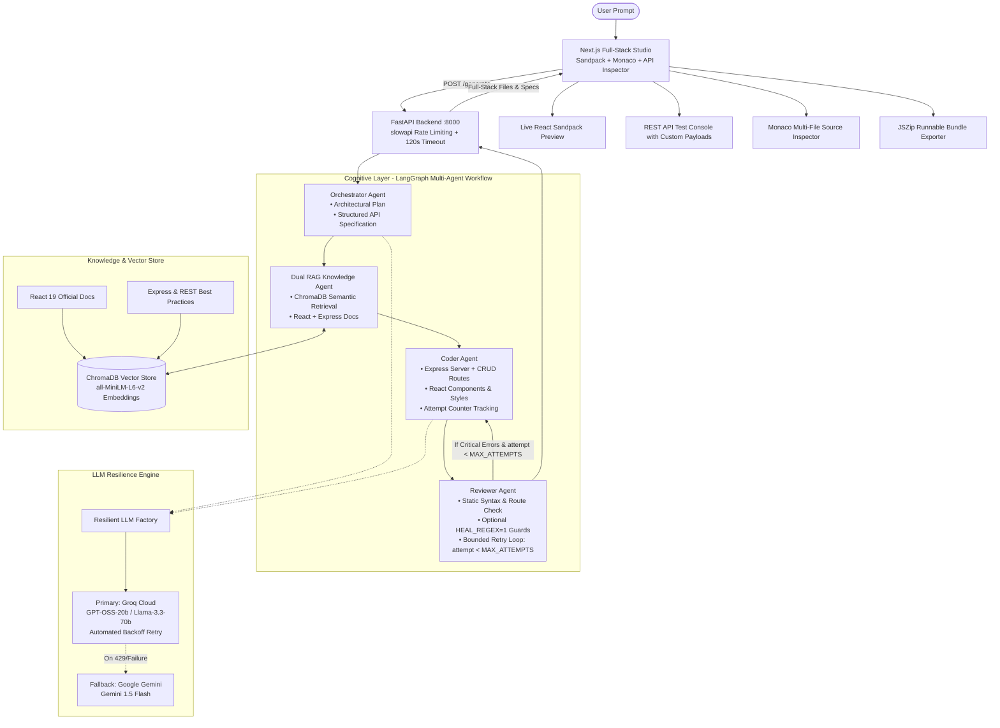

# Agentic IDE: Full-Stack AI Web App Engineering Studio

Agentic IDE is an autonomous full-stack web development studio that transforms natural language prompts into complete, production-grade, live-previewable web applications. Powered by a multi-agent LangGraph cognitive architecture, dual-domain Retrieval-Augmented Generation (RAG), and a resilient multi-provider LLM pipeline, Agentic IDE writes, reviews, auto-heals, and serves both the **Express.js REST API Backend** and the **React Interactive Frontend** in real time.

---

## 🚀 Key Features

* **Full-Stack Dual Code Generation:** Autonomously generates complete Node.js/Express.js backend services (`/server.js`, `/server/package.json`, seed data, REST routes, CORS middleware, `/api/health`) and modern React client applications (`/App.js`, `/styles.css`, `/services/api.js`).
* **Interactive Live Sandpack Preview:** Instant client-side code execution with zero build wait time directly inside the browser using CodeSandbox Sandpack.
* **Monaco Backend Multi-File Source Inspector:** Embedded Monaco code editor allowing users to toggle between `/server.js`, `/server/package.json`, and any auxiliary backend architecture files with full syntax highlighting.
* **Interactive REST API Inspector:** Built-in endpoint testing console supporting live latency measurement, parameter substitution (e.g. `:id` -> `1`), and an editable JSON payload editor for `POST`, `PUT`, and `PATCH` routes.
* **Dual-Mode API Client (`/services/api.js`):** Seamless hybrid client that attempts live HTTP connection to local port 5000, while gracefully falling back to an in-memory reactive store inside the browser preview sandbox.
* **One-Click Runnable Full-Stack Export (JSZip):** Downloads a ready-to-run ZIP archive containing structured `/server` and `/client` directories with quickstart scripts and instructions.
* **Modular Frontend Studio Architecture:**
  * **Componentized UI Shell:** Clean separation of concerns with `page.tsx` decoupled into dedicated components (`ChatPanel`, `PreviewPane`, `ApiInspector`, `ExportButton`) and a centralized `useGenerate` orchestration hook.
  * **Configurable Client Endpoints:** Dynamic environment configuration via `NEXT_PUBLIC_API_URL` and `NEXT_PUBLIC_EXPRESS_URL` with resilient local defaults.
  * **Strict TypeScript Type Safety:** Complete removal of `any` across the frontend studio, replaced by strong domain interfaces (`ApiEndpoint`, `StructuredError`, `ChatMessage`, `TestResult`, `GenerationResponse`).
  * **Explicit Simulated Response Labeling:** Fallback mock responses in the REST API Inspector are clearly badged with amber warnings (`MOCK / SIMULATED`) and never display misleading green success statuses.
  * **Real-Time Validation Diagnostics:** Visual surfacing of backend `"partial"` status and structured validator error lists (`[{file, line, rule, message}]`) in an expandable alert banner.
* **Bounded Multi-Attempt Self-Healing Loop:**
  * Clean separation between cognitive architecture planning and coder execution runs (`attempt`).
  * `MAX_ATTEMPTS` configurable via environment variable (default: 3).
  * Returns `status: "partial"` with remaining errors if issues persist after the final coder attempt.
  * Reviewer regex auto-healer guarded cleanly behind `HEAL_REGEX=1` (default off).
* **Delimited Block Code Generation & Parallel Generation:**
  * **Zero JSON Escaping:** Replaces single-giant-JSON with raw delimited blocks (`=== FILE: /path === ... === END FILE ===`), eliminating escaping errors and regex salvage.
  * **Parallel Backend & Frontend Generation:** Generates Node.js/Express backend and React frontend concurrently in two simultaneous LLM calls after planning, halving latency and doubling effective token throughput.
  * **Targeted Single-File Re-request:** On any parse omission, re-requests only the specific missing file instead of regenerating the entire project.
  * **Expanded Token Ceiling:** Model generation limit raised to 8192 tokens via `MAX_TOKENS` env variable.
* **Optimized Dual RAG & Token-Budgeted Context:**
  * **Selective Upstream Sync:** `knowledge_base/react.dev` git-ignored with `scripts/fetch_react_docs.py` fetching only `src/content/reference` and `src/content/learn`.
  * **Idempotent Ingestion (`backend/rag_ingest.py`):** Deterministic SHA-256 chunk IDs, selective paths, `domain="frontend"` metadata tagging, zero sleep stalls, and collection reset capabilities.
  * **Chroma Singleton & Domain Filtering (`backend/agents/knowledge.py`):** Embeddings and `langchain-chroma` initialized once at startup; isolated retrieval via `{"domain": "backend"}` and `{"domain": "frontend"}` with configurable `RAG_K` and `RAG_SCORE_THRESHOLD`.
  * **Token-Budgeted Context Packing (`backend/agents/coder.py`):** Prioritizes highest-scoring chunks within a token ceiling (`MAX_CONTEXT_TOKENS`) instead of arbitrary character slicing.
* **Deterministic AST & Static Validator Suite (`backend/validators.py`):**
  * **JS Syntax Check:** Runs `node --check` for `server.js` and `esbuild` for `App.js` and `api.js` to pinpoint exact file and line syntax errors.
  * **Route Contract Enforcement:** Parses `app.METHOD` route definitions, normalizes path parameters (`:id`), checks coverage against `api_spec`, and ensures every client URL in `services/api.js` maps to a registered server route.
  * **Strict Import Whitelist:** Whitelists `react`, `react-dom`, `lucide-react`, `express`, `cors`, and local relative imports. Dynamically introspects installed `lucide-react` exports to reject hallucinated icons.
  * **Strict package.json Verification:** Validates package descriptors with strict `json.loads` without blind single-quote rewriting.
  * **Targeted Feedback:** Reviewer formats structured errors (`[{file, line, rule, message}]`) and feeds only those errors directly to the coder.
* **API Security, Rate Limiting & Timeouts:**
  * Strict CORS policies driven by `FRONTEND_ORIGINS` (disallowing insecure wildcard + credentials combinations).
  * Built-in `slowapi` rate limiting on the `/generate` endpoint.
  * Async 120-second generation timeout preventing unhandled agent thread stalls.
  * Sanitized 500 error responses masking internal stack traces while emitting traceable `request_id` values.
* **Resilient Multi-Provider LLM Engine:** Primary high-speed execution with **Groq Cloud** (`openai/gpt-oss-20b` or `llama-3.3-70b-versatile`) with automated per-second backoff and seamless failover to **Google Gemini** (`gemini-1.5-flash`).
* **Dual RAG Knowledge Base:** ChromaDB vector database housing both official React documentation and curated Express.js/REST engineering patterns via local HuggingFace embeddings (`all-MiniLM-L6-v2`).
* **Celebration & Modern UX:** Micro-interactions, status pills, keyboard shortcuts (`Enter` to generate, `Shift+Enter` for new line), and celebratory confetti animations upon successful build.

---

## 🛠️ System Architecture



---

## 💻 Tech Stack

| Layer | Technology | Description |
|---|---|---|
| **Frontend Studio** | Next.js 16 (App Router), React 19, TypeScript | High-performance developer interface and application shell |
| **Styling** | TailwindCSS + Modern Glassmorphism CSS | Rich dark-mode UI with smooth micro-interactions and badges |
| **Code Preview** | `@codesandbox/sandpack-react` | In-browser isolated React bundler and virtual file system |
| **Source Inspector** | Monaco Editor (`@monaco-editor/react`) | Professional syntax highlighting and code inspection |
| **Icons & Feedback** | `lucide-react`, `canvas-confetti` | Modern iconography and celebratory visual feedback |
| **Export Engine** | `jszip` | Generates runnable full-stack zip distributions on the fly |
| **Backend Gateway** | FastAPI, Uvicorn, Pydantic, SlowAPI | High-throughput async REST server with rate limiting on port 8000 |
| **Agent Framework** | LangGraph & LangChain | Directed cyclical multi-agent graph with bounded self-healing |
| **Primary LLM** | Groq Cloud (`openai/gpt-oss-20b`, `llama-3.3-70b`) | Lightning-fast inference (sub-3s generation) with automated backoff |
| **Fallback LLM** | Google Gemini (`gemini-1.5-flash`) | Deep reasoning model with large context window fallback |
| **Vector Database** | ChromaDB | Persistent local semantic store for technical documentation |
| **Embeddings** | HuggingFace (`sentence-transformers/all-MiniLM-L6-v2`) | Local, zero-cost semantic embedding pipeline |

---

## 📂 Project Directory Structure

```
agentic-webdev/
├── backend/                         # Python FastAPI Backend & Agent Orchestrator
│   ├── agents/                      # Cognitive LangGraph Agents
│   │   ├── orchestrator.py          # Plans architecture & extracts structured REST API specs
│   │   ├── knowledge.py             # Dual-domain RAG retrieval (React + Express)
│   │   ├── coder.py                 # Generates full-stack files & tracks attempt counter
│   │   └── reviewer.py              # Validates syntax & optional HEAL_REGEX guards
│   ├── chroma_db/                   # Chroma Vector DB storing chunked documentation
│   ├── llm_factory.py               # Multi-provider ResilientLLM (Groq + Gemini fallback)
│   ├── graph.py                     # Compiled LangGraph workflow with MAX_ATTEMPTS bound
│   ├── state.py                     # TypedDict state definition (AgentState with attempt)
│   ├── main.py                      # FastAPI application with CORS, SlowAPI rate limit & 120s timeout
│   ├── rag_ingest.py                # React documentation chunking and embedding
│   ├── ingest_backend_docs.py       # Express & REST architecture knowledge ingestion
│   ├── requirements.txt             # Python dependencies
│   ├── test_suite.py                # Automated unit tests for reviewer, guards & real graph semantics
│   └── test_fullstack.py            # CLI verification script for end-to-end generation
├── frontend/                        # Next.js Full-Stack Developer Studio
│   ├── src/
│   │   ├── app/
│   │   │   ├── page.tsx             # Streamlined studio shell coordinator
│   │   │   ├── layout.tsx           # Application layout wrapper & crypto polyfill
│   │   │   └── globals.css          # Design system & dark mode styles
│   │   ├── components/
│   │   │   ├── ChatPanel.tsx        # Interactive chat interface & partial error alert banner
│   │   │   ├── PreviewPane.tsx      # Sandpack preview, Monaco editor, & architecture plan
│   │   │   ├── ApiInspector.tsx     # REST API testing console with explicit simulated badges
│   │   │   ├── ExportButton.tsx     # Runnable full-stack JSZip bundle downloader
│   │   │   └── Editor.tsx           # Monaco code editor component for backend sources
│   │   ├── hooks/
│   │   │   └── useGenerate.ts       # Centralized generation state and API hook
│   │   └── types/
│   │       └── studio.ts            # Strong TypeScript interfaces for studio domain
│   ├── .env.example                 # Frontend environment configuration template
│   ├── package.json                 # Frontend dependencies (Next.js, Sandpack, Lucide, JSZip, Confetti)
│   └── tsconfig.json                # TypeScript configuration
├── knowledge_base/                  # Source Markdown documentation for RAG ingestion
│   ├── react.dev/                   # Cloned official React documentation
│   └── backend/                     # Curated Express.js, REST, CORS, and Data Store guides
├── README.md                        # Project documentation and guide
├── architecture_and_workflow.md     # Deep architecture and cognitive workflow document
├── implementation_plan.md           # Implementation milestones and verification record
└── .env.example                     # Environment configuration template
```

---

## 🚦 Roadmap & Implementation Status

### Phase 1: Foundations & Scaffolding (Completed)
- [x] Initialized dual-workspace structure (`backend/` and `frontend/`).
- [x] Configured Next.js 16 with TailwindCSS and Sandpack React workspace.
- [x] Configured FastAPI backend with CORS middleware and Uvicorn hot-reload.

### Phase 2: LangGraph Core Flow (Completed)
- [x] Implemented cyclic LangGraph workflow with `AgentState`.
- [x] Built Orchestrator, Knowledge, Coder, and Reviewer agent nodes.
- [x] Configured conditional feedback loop (`should_continue`) bounded by `MAX_ATTEMPTS`.
- [x] Separated `attempt` counter to track coder generation cycles cleanly.

### Phase 3: Dual RAG Knowledge Base (Completed)
- [x] Ingested React 19 documentation into local ChromaDB.
- [x] Created curated Express.js and REST architecture guides in `knowledge_base/backend/`.
- [x] Ingested backend guides into ChromaDB with HuggingFace sentence transformers.
- [x] Connected Knowledge Agent to retrieve both frontend and backend documentation simultaneously.

### Phase 4: Full-Stack Generation & Studio Experience (Completed)
- [x] Upgraded Coder Agent to produce complete Express.js servers, seed stores, and REST endpoints.
- [x] Engineered dual-mode `/services/api.js` client for seamless preview and local server execution.
- [x] Built interactive **Backend REST API Inspector** with live endpoint testing, latency counter, and editable payload inspector.
- [x] Built **Monaco Multi-File Source Inspector** allowing switching between `/server.js` and `/server/package.json`.
- [x] Built **ZIP Project Exporter** producing organized `/server` and `/client` projects with universal startup scripts.

### Phase 5: Reliability, Security & Runtime Immunity (Completed)
- [x] Integrated Groq Cloud as high-speed primary LLM (`openai/gpt-oss-20b`) with smart backoff retry.
- [x] Implemented automatic fallback to Google Gemini (`gemini-1.5-flash`).
- [x] Cleaned default reviewer path and placed regex healing behind `HEAL_REGEX=1`.
- [x] Added `slowapi` rate limiting and a 120s generation timeout to `/generate`.
- [x] Configured environment-driven CORS origins via `FRONTEND_ORIGINS` removing wildcard + credentials combos.
- [x] Sanitized 500 error responses with traceable `request_id`.
- [x] Emitted `status: "partial"` with remaining errors if issues persist after final attempt.

---

### Phase 6: Deterministic AST & Static Validators (Completed)
- [x] Built `backend/check_syntax.js` with `esbuild` for JSX and JS syntax parsing.
- [x] Built `backend/validators.py` enforcing syntax, route contracts, import allowlists, and package.json validity.
- [x] Configured Reviewer node to return structured error objects `[{file, line, rule, message}]`.
- [x] Fed only structured reviewer errors to Coder Agent prompt for targeted auto-correction.
- [x] Added comprehensive pytest regression suite (`backend/test_validators.py`) covering await, `.data.map`, `string .slice`, and comments corruption cases.

### Phase 7: RAG Optimization, Singleton Chroma & Token Budgeting (Completed)
- [x] Untracked `knowledge_base/react.dev` from git cache and added to `.gitignore`.
- [x] Created `scripts/fetch_react_docs.py` for selective reference and learn documentation fetching.
- [x] Overhauled `backend/rag_ingest.py` to be idempotent with deterministic SHA-256 chunk IDs, selective path filtering, frontend domain metadata, and zero sleeps.
- [x] Upgraded `backend/agents/knowledge.py` to `langchain-chroma` with startup singleton vectorstore, domain filtering, and env-driven `RAG_K` and `RAG_SCORE_THRESHOLD`.
- [x] Upgraded `backend/agents/coder.py` with token-budgeted context packing prioritizing top relevance-scoring chunks.

### Phase 8: Delimited Block Generation & Parallel Execution (Completed)
- [x] Replaced single-giant-JSON generation with raw delimited block parsing (`backend/file_parser.py`).
- [x] Implemented concurrent parallel Backend and Frontend LLM generation pipelines in `backend/agents/coder.py`.
- [x] Added targeted single-file re-request recovery on any parse failure or omitted required files.
- [x] Raised model token output limits to 8192 tokens across Groq and Gemini (`MAX_TOKENS`).
- [x] Removed `unescape_json_string` and JSON regex fallback matchers; added pytest test coverage.

## 🏃 Quickstart & Local Setup

### Prerequisites
- **Node.js**: v18.0.0 or higher (v20+ recommended)
- **Python**: v3.10 or higher
- API Keys:
  - **Groq API Key** (Free tier available at [console.groq.com](https://console.groq.com))
  - **Google Gemini API Key** (Free tier at [aistudio.google.com](https://aistudio.google.com))

### 1. Configure Environment Variables
Copy `.env.example` to `.env` in the root directory and in `backend/.env`:
```bash
cp .env.example .env
cp .env.example backend/.env
```

Configure your environment variables:
```env
# Primary LLM (Groq Cloud)
GROQ_API_KEY=gsk_your_groq_api_key_here
GROQ_MODEL=openai/gpt-oss-20b

# Fallback LLM (Google Gemini)
GOOGLE_API_KEY=your_gemini_api_key_here
LLM_MODEL=gemini-1.5-flash

# Loop Semantics & Healer Controls
MAX_ATTEMPTS=3
HEAL_REGEX=0

# Security & CORS
FRONTEND_ORIGINS=http://localhost:3000,http://127.0.0.1:3000
RATE_LIMIT=10/minute
GENERATION_TIMEOUT=180 # per-attempt budget (default: 180s)
MAX_PROMPT_LENGTH=5000
```

### 2. Start the Backend API Server
```bash
cd backend
python -m venv venv

# On Windows:
.\venv\Scripts\Activate.ps1
# On macOS/Linux:
source venv/bin/activate

pip install -r requirements.txt

# (Optional) Seed the Vector Knowledge Base:
python ingest_backend_docs.py

# Launch FastAPI on port 8000:
uvicorn main:app --reload --host 0.0.0.0 --port 8000
```

### 3. Start the Frontend Studio
In a new terminal:
```bash
cd frontend
npm install
npm run dev
```

Open [http://localhost:3000](http://localhost:3000) in your browser to begin creating full-stack applications!

---

## 🧪 Testing & Verification

### Running Static Validator Pytest Suite
Execute the pytest regression test suite covering syntax errors, route contracts, import allowlists, package.json parsing, and regression corruptions:
```bash
pytest backend/test_validators.py
```

### Running Backend Unit Tests
Execute the automated unit test suite covering reviewer auto-healer, real LangGraph `should_continue` semantics, and sanitizers:
```bash
python backend/test_suite.py
```

### Running Full-Stack Generation CLI
Verify end-to-end agentic workflow from the command line:
```bash
cd backend
python test_fullstack.py
```

---

## 💡 Example Prompts to Try

* **Expense Tracker:**
  > *"Personal Expense & Budget Tracker with spending categories, monthly allowance progress bars, expense logging form, and category breakdown"*
* **Kanban Board:**
  > *"Team Sprint & Kanban Board with status columns (Todo, In Progress, Review, Done), priority tags, assignee avatars, and task creation"*
* **Crypto Watchlist:**
  > *"Crypto & Stock Portfolio Watchlist with simulated price feeds, profit/loss calculations, buy/sell logger, and asset distribution"*
* **E-Commerce Catalog:**
  > *"Sneaker Marketplace catalog with category filters, price range slider, cart drawer, and checkout simulation"*
* **Developer Console:**
  > *"API Key & Webhook Management Console with token generation, usage quotas, toggle permissions, and request activity logs"*
