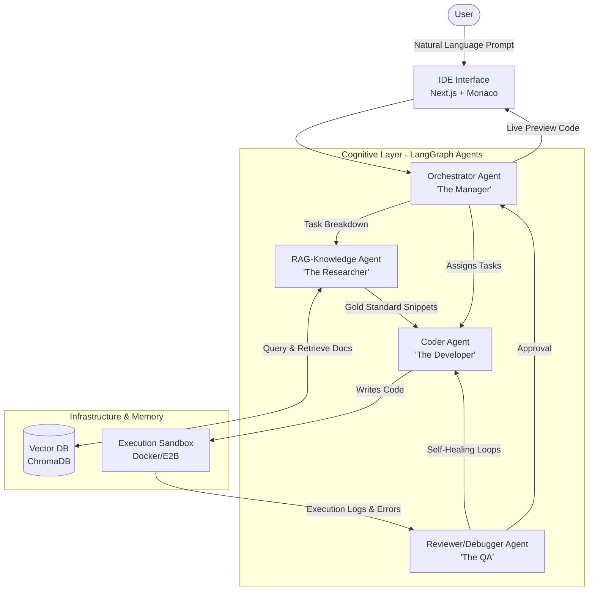

# Agentic IDE: Full-Stack Agent-Based Web App Developer

Agentic IDE is an advanced web development platform that converts natural language prompts into fully functional, live-previewable web applications. It orchestrates multiple specialized AI agents under the hood, utilizing a self-healing LangGraph workflow and Retrieval-Augmented Generation (RAG) for up-to-date documentation.

---

## 🚀 Plan of Action & Roadmap

We are implementing this project in structured phases. Below is the current implementation status and the roadmap ahead.

### Phase 1: Foundation & Scaffolding (Completed)
- [x] Create project layout (`backend/` and `frontend/`).
- [x] Configure standard root `.gitignore` and local environment file `.env`.
- [x] Scaffold Next.js frontend structure with Sandpack React workspace integration.
- [x] Scaffold FastAPI backend endpoints and LangGraph environment configurations.

### Phase 2: LangGraph Core Flow (Completed)
- [x] Define LangGraph agent state (`AgentState`) to hold prompt, plan, files, errors, and metadata.
- [x] Implement **Orchestrator Agent** to break down user prompt into clear actionable technical plans.
- [x] Implement **RAG Knowledge Agent** stub for document retrieval integration.
- [x] Implement **Coder Agent** to write actual codes, returning structured JSON files.
- [x] Implement **Reviewer Agent** with self-healing feedback loop capability.
- [x] Wire state nodes into a compiler-ready LangGraph workflow.

### Phase 3: RAG Database Populating (Completed)
- [x] Clone open-source Web Dev reference libraries (`knowledge_base/react.dev` cloned).
- [x] Implement `rag_ingest.py` to chunk Markdown, MDX, and PDF documentation and load them into ChromaDB (35MB vector database generated).
- [x] Wire vector database retrieval logic directly into the **RAG Knowledge Agent** (uses HuggingFace local sentence-transformers to retrieve gold standard context).

### Phase 4: Dynamic Sandbox & Execution (Active)
- [/] Set up E2B / Docker Sandbox connectors (tested connectivity using `test_e2b.py`).
- [ ] Connect the Reviewer Agent to actively execute code in the sandbox during generation rather than returning mock results.
- [ ] Capture execution logs/errors and feed stderr back to the Coder Agent for iterative self-healing.

### Phase 5: Hosting & Production Deployments (Next Steps)
- [ ] Connect Orchestrator to Vercel/Netlify hosting APIs.
- [ ] Return live preview URLs of completed applications directly to the interactive Next.js editor.

---

## 📂 Project Directory Structure

```
agentic-webdev/
├── backend/                  # Python FastAPI Backend & LangGraph Agent Pipeline
│   ├── agents/               # Cognitive Agent Nodes
│   │   ├── orchestrator.py   # Technical plans breakdown (Gemini)
│   │   ├── knowledge.py      # Retrieves context from vector DB (RAG)
│   │   ├── coder.py          # Generates codebase files structure (JSON)
│   │   └── reviewer.py       # Validates output / Mock Debugger stub
│   ├── chroma_db/            # Chroma Vector DB storing chunked documentation
│   ├── main.py               # FastAPI gateway server running on port 8000
│   ├── graph.py              # Compiled LangGraph Workflow connecting the nodes
│   ├── state.py              # LangGraph AgentState definitions
│   ├── rag_ingest.py         # Loads/splits MD, MDX, PDF documentation into ChromaDB
│   ├── requirements.txt      # Python dependencies list
│   └── test_*.py             # CLI scripts for testing API, graph, E2B
├── frontend/                 # Next.js Front-end App & Monaco Editor Sandbox Workspace
│   ├── src/
│   │   ├── app/
│   │   │   ├── page.tsx      # Main Page with editor workspace & AI developer chat
│   │   │   └── layout.tsx    # General wrapper layout
│   │   └── components/
│   │       └── Editor.tsx    # Custom Monaco Code Editor component
│   └── package.json          # Node dependencies (Next.js, Sandpack, Monaco)
├── knowledge_base/           # Repository source markdown/PDF files for RAG ingestion
│   └── react.dev/            # Cloned local repository of React dev documentation
├── architecture_and_workflow.md # Architectural design specifications
└── implementation_plan.md    # Initial implementation checklist & verification plan
```

---

## 🛠️ System Architecture



1. **Orchestrator Agent:** The "Manager" that handles user intent, splits requirements into code tasks, and maintains overall state.
2. **RAG-Knowledge Agent:** The "Researcher" that fetches the correct syntax blocks and APIs from the local Vector DB.
3. **Coder Agent:** The "Developer" that builds raw React and HTML/JS file structures in a structured format.
4. **Reviewer Agent:** The "QA" that runs the generated code inside a sandbox, captures issues, and teaches the Coder how to fix them recursively.

---

## 💻 Tech Stack

- **Frontend:** Next.js (React), TailwindCSS, CodeSandbox Sandpack (for in-browser preview & file explorer)
- **Backend Framework:** FastAPI (Python 3.10+)
- **Agent Orchestration:** LangGraph & LangChain
- **AI Models:** Gemini 2.5 Flash (via `langchain-google-genai`)
- **Knowledge Memory:** ChromaDB (Vector Database) for document retrieval

---

## 🏃 Run Local Setup

### Prerequisites
- Node.js (v18+)
- Python (v3.10+)

### 1. Configure Environments
Create a `.env` file at the root directory of the project:
```env
GOOGLE_API_KEY=your_gemini_api_key
HF_TOKEN=your_huggingface_token
E2B_API_KEY=your_optional_e2b_api_key
```

### 2. Launch Backend Server
```bash
cd backend
python -m venv venv
# On Windows:
.\venv\Scripts\Activate.ps1
# On Unix:
source venv/bin/activate

pip install -r requirements.txt
uvicorn main:app --reload --port 8000
```

### 3. Launch Frontend Server
```bash
cd frontend
npm install
npm run dev
```
Open [http://localhost:3000](http://localhost:3000) to view the web application.
