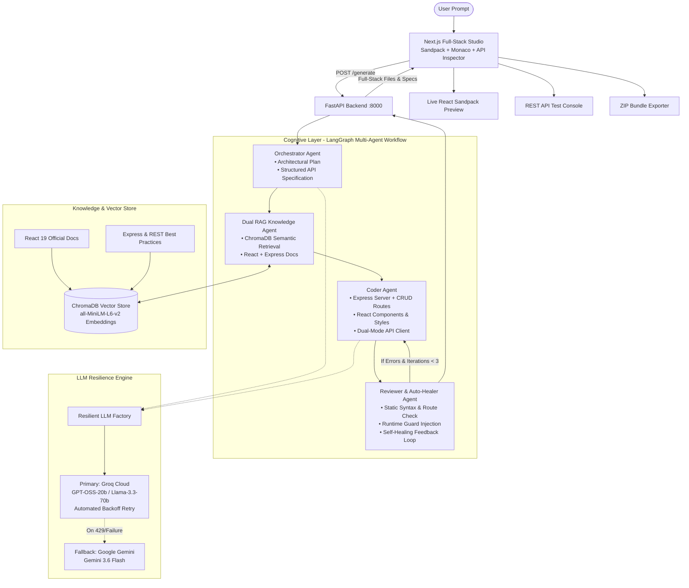

# Agentic IDE: Full-Stack AI Web App Engineering Studio

Agentic IDE is an autonomous full-stack web development studio that transforms natural language prompts into complete, production-grade, live-previewable web applications. Powered by a multi-agent LangGraph cognitive architecture, dual-domain Retrieval-Augmented Generation (RAG), and a resilient multi-provider LLM pipeline, Agentic IDE writes, reviews, auto-heals, and serves both the **Express.js REST API Backend** and the **React Interactive Frontend** in real time.

---

## 🚀 Key Features

* **Full-Stack Dual Code Generation:** Generates complete Node.js/Express.js backend services (`/server.js`, seed data, REST routes, CORS, `/api/health`) and modern React client applications (`/App.js`, `/styles.css`).
* **Interactive Live Sandpack Preview:** Instant client-side code execution with zero build wait time directly inside the browser.
* **Dual-Mode API Client (`/services/api.js`):** Seamless hybrid client that attempts live HTTP connection to local port 5000, while falling back to an in-memory reactive store inside the browser preview sandbox.
* **Interactive REST API Inspector:** Built-in endpoint testing console allowing users to test `GET`, `POST`, `PUT`, `DELETE` endpoints, measure response latency, inspect payloads, and copy server code.
* **3-Layer Defensive Immunity & Auto-Healer:**
  1. *Client-side sanitizer:* Excludes server files from Sandpack, auto-initializes `useState([])`, wraps array transformations (`.map`, `.filter`, `.reduce`), and guards `.toFixed`.
  2. *Reviewer Auto-Healer:* Server-side AST/regex repair agent that fixes uninitialized state and single-quoted `package.json` files before transmission.
  3. *Coder Prompt Hardening:* Strict defensive coding patterns enforced on the LLM.
* **Resilient Multi-Provider LLM Engine:** Primary high-speed execution with **Groq Cloud** (`openai/gpt-oss-20b` or `llama-3.3-70b-versatile`) with automated per-second backoff and seamless failover to **Google Gemini** (`gemini-3.6-flash`).
* **Dual RAG Knowledge Base:** ChromaDB vector database housing both official React documentation and curated Express.js/REST engineering patterns via local HuggingFace embeddings.
* **One-Click Full-Stack Export:** Downloads a ready-to-run ZIP archive containing structured `/server` and `/client` directories with quickstart instructions.

---

## 🛠️ System Architecture



---

## 💻 Tech Stack

| Layer | Technology | Description |
|---|---|---|
| **Frontend Studio** | Next.js 16 (App Router), React 19, TypeScript | High-performance developer interface and application shell |
| **Styling** | TailwindCSS + Modern Glassmorphism CSS | Rich dark-mode UI with smooth micro-interactions and badges |
| **Code Preview** | `@codesandbox/sandpack-react` | In-browser isolated React bundler and virtual file system |
| **Icons & UI** | `lucide-react`, `canvas-confetti` | Sleek modern iconography and interactive feedback |
| **Export Engine** | `jszip` | Generates runnable full-stack zip distributions on the fly |
| **Backend Gateway** | FastAPI, Uvicorn (Python 3.10+) | High-throughput async REST server running on port 8000 |
| **Agent Framework** | LangGraph & LangChain | Directed cyclical multi-agent graph with conditional self-healing |
| **Primary LLM** | Groq Cloud (`openai/gpt-oss-20b`, `llama-3.3-70b`) | Lightning-fast inference (sub-3s generation) with automated backoff |
| **Fallback LLM** | Google Gemini (`gemini-3.6-flash`) | Deep reasoning model with large context window fallback |
| **Vector Database** | ChromaDB | Persistent local semantic store for technical documentation |
| **Embeddings** | HuggingFace (`sentence-transformers/all-MiniLM-L6-v2`) | Local, zero-cost semantic embedding pipeline |

---

## 📂 Project Directory Structure

```
agentic-webdev/
├── backend/                         # Python FastAPI Backend & Agent Orchestrator
│   ├── agents/                      # Cognitive LangGraph Agents
│   │   ├── orchestrator.py          # Plans architecture & extracts structured REST API specs
│   │   ├── knowledge.py             # Dual-domain RAG retrieval (React + Express)
│   │   ├── coder.py                 # Generates full-stack files (Express server + React UI)
│   │   └── reviewer.py              # Validates syntax & auto-heals React/package code
│   ├── chroma_db/                   # Chroma Vector DB storing chunked documentation
│   ├── llm_factory.py               # Multi-provider ResilientLLM (Groq + Gemini fallback)
│   ├── graph.py                     # Compiled LangGraph cyclical state workflow
│   ├── state.py                     # TypedDict state definition (AgentState)
│   ├── main.py                      # FastAPI application with CORS & /generate endpoint
│   ├── rag_ingest.py                # React documentation chunking and embedding
│   ├── ingest_backend_docs.py       # Express & REST architecture knowledge ingestion
│   ├── requirements.txt             # Python dependencies
│   └── test_fullstack.py            # CLI verification script for end-to-end generation
├── frontend/                        # Next.js Full-Stack Developer Studio
│   ├── src/
│   │   └── app/
│   │       ├── page.tsx             # Studio interface: Chat, Sandpack, API Tester, Plan
│   │       ├── layout.tsx           # Application layout wrapper
│   │       └── globals.css          # Design system & dark mode styles
│   ├── package.json                 # Frontend dependencies (Next.js, Sandpack, Lucide, JSZip)
│   └── tsconfig.json                # TypeScript configuration
├── knowledge_base/                  # Source Markdown documentation for RAG ingestion
│   ├── react.dev/                   # Cloned official React documentation
│   └── backend/                     # Curated Express.js, REST, CORS, and Data Store guides
├── README.md                        # Project documentation and guide
└── .env                             # Environment variables & API keys
```

---

## 🚦 Roadmap & Implementation Status

### Phase 1: Foundations & Scaffolding (Completed)
- [x] Initialized dual-workspace structure (`backend/` and `frontend/`).
- [x] Configured Next.js 16 with TailwindCSS and Sandpack React workspace.
- [x] Configured FastAPI backend with CORS middleware and Uvicorn hot-reload.

### Phase 2: LangGraph Core Flow (Completed)
- [x] Implemented cyclic LangGraph workflow with `AgentState`.
- [x] Built Orchestrator, Knowledge, Coder, and Reviewer agent nodes.
- [x] Configured conditional feedback loop (`should_continue`) for self-healing.

### Phase 3: Dual RAG Knowledge Base (Completed)
- [x] Ingested React 19 documentation into local ChromaDB.
- [x] Created curated Express.js and REST architecture guides in `knowledge_base/backend/`.
- [x] Ingested backend guides into ChromaDB with HuggingFace sentence transformers.
- [x] Connected Knowledge Agent to retrieve both frontend and backend documentation simultaneously.

### Phase 4: Full-Stack Generation & Studio Experience (Completed)
- [x] Upgraded Coder Agent to produce complete Express.js servers, seed stores, and REST endpoints.
- [x] Engineered dual-mode `/services/api.js` client for seamless preview and local server execution.
- [x] Built interactive **Backend REST API Inspector** with live endpoint testing, latency counter, and payload inspection.
- [x] Built **ZIP Project Exporter** producing organized `/server` and `/client` projects.

### Phase 5: Reliability & Runtime Immunity (Completed)
- [x] Integrated Groq Cloud as high-speed primary LLM (`openai/gpt-oss-20b`) with smart backoff retry.
- [x] Implemented automatic fallback to Google Gemini (`gemini-3.6-flash`).
- [x] Built **3-Layer Defensive Immunity System** against `Cannot read properties of undefined (reading 'map')`.
- [x] Added robust `parsePackageJson` to handle comments, single quotes, and code blocks safely.

### Phase 6: Cloud Deployment & One-Click Hosting (Next Steps)
- [ ] Connect Orchestrator to Vercel/Netlify for instant frontend cloud deploys.
- [ ] Connect backend to Render/Fly.io APIs for containerized Express deployments.

---

## 🏃 Quickstart & Local Setup

### Prerequisites
- **Node.js**: v18.0.0 or higher
- **Python**: v3.10 or higher
- API Keys:
  - **Groq API Key** (Free tier available at [console.groq.com](https://console.groq.com))
  - **Google Gemini API Key** (Free tier at [aistudio.google.com](https://aistudio.google.com))

### 1. Configure Environment Variables
Create a `.env` file in the root directory and in `backend/.env`:
```env
# Primary LLM (Groq Cloud)
GROQ_API_KEY=gsk_your_groq_api_key_here
GROQ_MODEL=openai/gpt-oss-20b

# Fallback LLM (Google Gemini)
GOOGLE_API_KEY=your_gemini_api_key_here
LLM_MODEL=gemini-3.6-flash

# Optional HuggingFace Token
HF_TOKEN=your_huggingface_token_optional
```

### 2. Start the Backend API Server
```bash
cd backend
python -m venv venv

# On Windows:
.\venv\Scripts\Activate.ps1
# On macOS/Linux:
source venv/bin/activate

pip install -r requirements.txt

# (Optional) Seed the Vector Knowledge Base if not already present:
python ingest_backend_docs.py

# Launch FastAPI on port 8000:
uvicorn main:app --reload --host 0.0.0.0 --port 8000
```

### 3. Start the Frontend Studio
In a new terminal:
```bash
cd frontend
npm install
npm run dev
```

Open [http://localhost:3000](http://localhost:3000) in your browser to begin creating full-stack applications!

---

## 💡 Example Prompts to Try

* **Expense Tracker:**
  > *"Personal Expense & Budget Tracker with spending categories, monthly allowance progress bars, expense logging form, and category breakdown"*
* **Kanban Board:**
  > *"Team Sprint & Kanban Board with status columns (Todo, In Progress, Review, Done), priority tags, assignee avatars, and task creation"*
* **Crypto Watchlist:**
  > *"Crypto & Stock Portfolio Watchlist with simulated price feeds, profit/loss calculations, buy/sell logger, and asset distribution"*
* **E-Commerce Catalog:**
  > *"Sneaker Marketplace catalog with category filters, price range slider, cart drawer, and checkout simulation"*
* **Developer Console:**
  > *"API Key & Webhook Management Console with token generation, usage quotas, toggle permissions, and request activity logs"*
