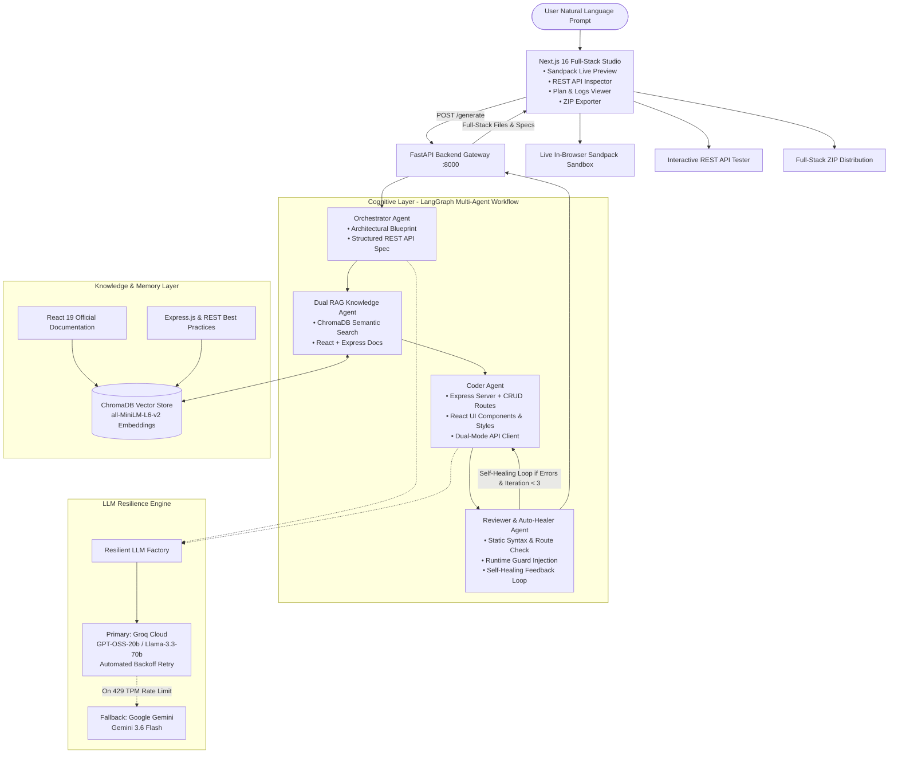
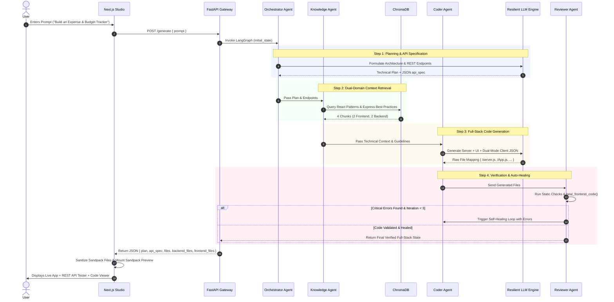

# Agentic IDE: Full-Stack Architecture & Cognitive Workflow

> [!NOTE]
> **Vision:** An autonomous full-stack AI web development engineering platform that translates natural language prompts into complete, verified, live-previewable web applications featuring both a **Node.js / Express.js REST API Backend** and a **React Interactive Frontend**.

---

## 1. System Architecture (The "Brain & Hands")

The architecture integrates a cyclical multi-agent cognitive graph (LangGraph), a dual-provider resilient LLM engine, a dual-domain Vector Knowledge Base (ChromaDB), and an in-browser isolated execution sandbox (CodeSandbox Sandpack).

### High-Level Architecture Diagram



---

## 2. The 4 Cognitive Agents

### 1. Orchestrator Agent (The System Architect)
* **Responsibility:** Deconstructs user requirements into a comprehensive technical blueprint and a structured REST API specification.
* **Outputs:** 
  * Architectural overview and feature roadmap.
  * Formal API route specifications: HTTP methods (`GET`, `POST`, `PUT`, `DELETE`), paths (e.g. `/api/items`), route descriptions, and sample request/response payloads.

### 2. Dual RAG Knowledge Agent (The Technical Researcher)
* **Responsibility:** Retrieves validated, gold-standard code patterns from the local vector database across two domains:
  * **Frontend:** React 19 hooks, component lifecycles, and Tailwind styling patterns.
  * **Backend:** Express.js routing, in-memory data modeling, CORS configuration, error-handling middleware, and REST status codes.
* **Vector Store:** ChromaDB with local HuggingFace `sentence-transformers/all-MiniLM-L6-v2` embeddings (zero external latency and zero cost).

### 3. Coder Agent (The Full-Stack Software Engineer)
* **Responsibility:** Generates both the backend server and frontend client as a unified, cohesive JSON file tree:
  * `/server.js`: Complete Node.js/Express.js backend with seed data, REST routes, CORS middleware, and `/api/health`.
  * `/server/package.json`: Backend package descriptor specifying Express and CORS dependencies.
  * `/services/api.js`: Intelligent dual-mode API client that attempts live HTTP connection to `http://localhost:5000`, with graceful fallback to an in-memory preview store inside Sandpack.
  * `/App.js`: Complete, interactive React component with search, filtering, creation/editing forms, metrics, and state badges.
  * `/styles.css`: Modern CSS styling with smooth micro-animations, glassmorphism cards, and responsive layouts.
  * `/package.json`: Client package descriptor specifying `lucide-react`.

### 4. Reviewer & Auto-Healer Agent (The QA Engineer & Healer)
* **Responsibility:** Analyzes all generated files for correctness, compliance with the API specification, and runtime safety.
* **Auto-Healing Pipeline:**
  * Detects missing routes or unstarted servers in `/server.js`.
  * Automatically injects defensive runtime guards into React code (`(items || []).map(...)`, `(Number(val) || 0).toFixed(2)`).
  * Auto-heals uninitialized `useState()` hooks to `useState([])`.
  * Standardizes single-quoted `package.json` files to strictly valid double-quoted JSON.
* **Cyclic Loop:** If critical structural errors are detected, returns feedback to the Coder Agent for self-healing (up to 3 iterations).

---

## 3. The End-to-End Agentic Workflow



---

## 4. The 3-Layer Defensive Immunity System

To eliminate runtime crashes in Sandpack (such as `Cannot read properties of undefined (reading 'map')`), the system enforces three independent defense perimeters:

```mermaid
flowchart TD
    subgraph Layer 3: Coder Prompt Hardening
        L3A[Strict Prompt Rules] --> L3B[Collection state MUST be useState array]
        L3A --> L3C[Collections MUST use defensive map/filter]
        L3A --> L3D[API functions MUST return mock arrays in catch block]
    end

    subgraph Layer 2: Server-Side Reviewer Auto-Healer
        L2A[heal_frontend_code] --> L2B[Replaces bare useState with useState array]
        L2A --> L2C[Wraps bare array methods with var or empty array]
        L2A --> L2D[Wraps toFixed with Number conversion fallback]
        L2A --> L2E[Converts single-quoted package.json to double quotes]
    end

    subgraph Layer 1: Client-Side Sandpack Sanitizer
        L1A[page.tsx Filter & Sanitizer] --> L1B[Excludes backend server files from Sandpack]
        L1A --> L1C[Robust parsePackageJson with regex fallback]
        L1A --> L1D[Client-side array and number guard regex]
        L1A --> L1E[Fallback mock API store injection if missing]
    end

    Layer 3 --> Layer 2 --> Layer 1 --> Sandbox[100% Crash-Free Sandpack Live Preview]
```

---

## 5. Technology Stack Summary

| Component | Technology | Role |
|:---|:---|:---|
| **Frontend IDE** | Next.js 16 (App Router), React 19, TypeScript | Reactive developer studio shell |
| **Styling** | Vanilla CSS + TailwindCSS Utilities | Modern dark-mode UI with sleek glassmorphism |
| **In-Browser Sandbox** | `@codesandbox/sandpack-react` | Zero-latency, browser-isolated React bundler |
| **Backend Gateway** | FastAPI, Uvicorn (Python 3.12) | High-concurrency async REST server on port 8000 |
| **Agent Orchestration** | LangGraph & LangChain Core | Cyclical, multi-node state graph with conditional branching |
| **Primary LLM** | Groq Cloud (`openai/gpt-oss-20b`, `llama-3.3-70b`) | Ultra-fast token generation (~3s) with automated backoff retry |
| **Fallback LLM** | Google Gemini (`gemini-3.6-flash`) | High-capacity fallback reasoning engine |
| **Vector Database** | ChromaDB | Local persistent store for technical documentation |
| **Embedding Engine** | HuggingFace `sentence-transformers/all-MiniLM-L6-v2` | Zero-cost, local semantic vectorizer |
| **Export Utility** | `jszip` | On-the-fly packaging of runnable full-stack projects |

---

## 6. Execution & Sandbox Strategy

* **In-Browser Sandpack Sandbox:** Client-side React code executes inside an isolated iframe managed by Sandpack. No local Docker installation is required.
* **Dual-Mode Client Architecture:** `/services/api.js` enables the generated app to run out-of-the-box inside the browser sandbox using in-memory mock data, while instantly connecting to `http://localhost:5000` when the user starts the local Express server.
* **Zero Backend Bundle Pollution:** Backend files (`/server.js`, `/server/package.json`) are filtered out before reaching Sandpack, preventing Node.js module resolution errors in the browser.


---

## 7. Backend Services: Responsibilities & Communication

The Agentic IDE uses two separate backend services that work together to provide full-stack application generation.

### 7.1 FastAPI Backend (Port 8000)

The FastAPI backend acts as the main orchestration gateway. It receives user prompts from the frontend studio and coordinates the multi-agent workflow.

Responsibilities:
- Accept application-generation requests through the `/generate` endpoint.
- Coordinate the Orchestrator, Knowledge, Coder, and Reviewer agents.
- Manage communication with the configured LLM providers.
- Return generated application files and technical specifications to the frontend.

### 7.2 Generated Express.js Backend (Port 5000)

The Express.js backend is generated for the applications created by the IDE.

Responsibilities:
- Provide REST API endpoints for generated applications.
- Handle application data and CRUD operations.
- Support communication between the generated frontend and backend.
- Provide an API health-check endpoint.

### 7.3 Communication Between Services

The frontend studio communicates with the FastAPI gateway for application generation. The generated application's API client can communicate with its Express.js backend when running locally.

This separation keeps AI orchestration independent from the backend services generated for individual applications.
