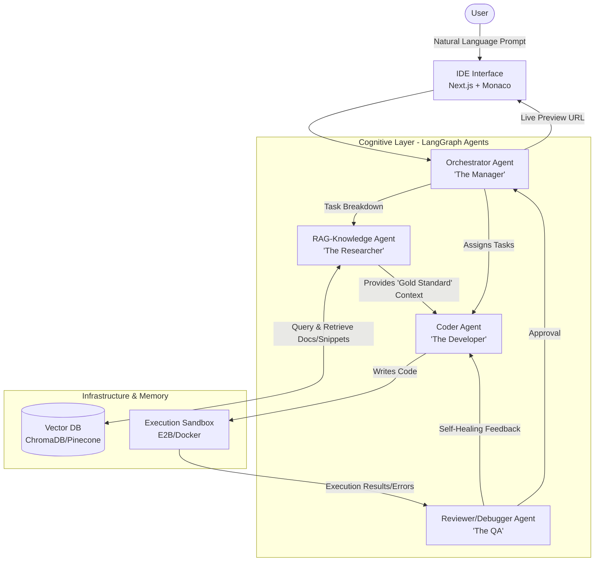
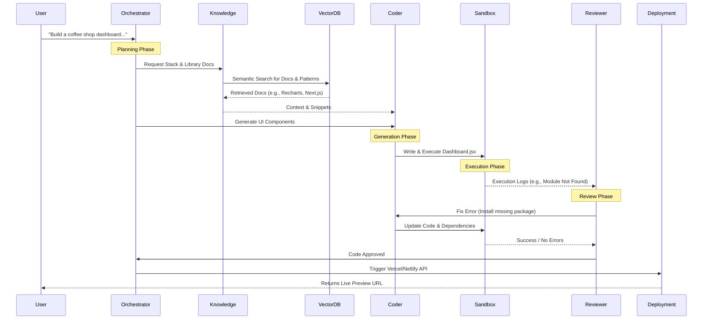

# Agent-Based LLM for Web Application Development

> [!NOTE]
> **Vision:** A platform that converts natural language prompts into full-stack, deployed web applications by orchestrating multiple specialized AI agents with real-time access to technical documentation (RAG).

## 1. System Architecture (The "Brain & Hands")

The architecture is divided into the cognitive processing layer (Agents) and the execution environment (Infrastructure).

### Architectural Diagram

## 2. The 4 Key Agents

1. **Orchestrator Agent (The Manager):** Analyzes the prompt, breaks it into actionable technical tasks, and maintains the overall state of the application being built.
2. **RAG-Knowledge Agent (The Researcher):** Queries the Vector Database when specific technical context is needed (e.g., "How to use Stripe in Next.js?"), retrieving up-to-date documentation and code templates.
3. **Coder Agent (The Developer):** Receives the technical tasks and the researched context to write the actual code files (Frontend, Backend, configurations).
4. **Reviewer/Debugger Agent (The QA):** Monitors the execution of the generated code within the sandbox. It captures errors and provides specific instructions back to the Coder Agent for self-healing and bug fixing.

## 3. The "Agentic RAG" Workflow

The workflow outlines the step-by-step process from user prompt to deployed application.

### Detailed Workflow Steps:
1. **User Input:** The user provides a high-level idea.
2. **Planning:** The Orchestrator decides on the technical stack and libraries.
3. **Retrieval (RAG):** The Knowledge Agent searches the Vector DB for the latest documentation, UI patterns, and best practices.
4. **Generation:** The Coder Agent writes the code using the retrieved snippets.
5. **Execution & Review (Self-Healing Loop):** Code is run in a secure Sandbox. If errors occur, the Reviewer instructs the Coder to fix them until the build passes.
6. **Deployment:** Upon approval, the site is deployed, and a live preview is shown to the user.

## 4. The Retrieval-Augmented Generation (RAG) System

The RAG acts as the "Long-term Memory" and is structured into specific chunks:
- **Framework Documentation:** Latest React, Next.js, Tailwind, etc.
- **"Gold Standard" Snippets:** Pre-built auth blocks, schemas, and UI components.
- **Industry Standards:** Domain-specific rules (e.g., HIPAA for medical, SEO for E-commerce).

## 5. Technology Stack

| Category | Tool / Framework | Purpose |
| :--- | :--- | :--- |
| **Agent Framework** | LangGraph | Manages the complex state and loops (Code → Error → Fix). |
| **LLM Model** | Gemini 1.5 Flash | Chosen for its massive context window to process codebases. |
| **Vector DB** | ChromaDB / Pinecone | Stores and retrieves technical docs for RAG. |
| **Execution Sandbox**| E2B / Docker | Secure cloud environment to run `npm install` and tests. |
| **Frontend UI** | Next.js + Monaco Editor| "Cursor-like" UI with an interactive editor and chat. |
| **Backend** | Python 3.11+ | Hosts the agent orchestration logic. |

## 6. Deployment & Security Considerations

> [!WARNING]
> Security in agentic systems requires strict sandboxing, as agents have the agency to execute code autonomously.

**Security:**
*   **Prompt Leakage:** Use PII redaction filters before sending data.
*   **Insecure Code:** The Reviewer Agent specifically scans for security anti-patterns (e.g., SQL injections).
*   **Dependency Risks:** Agents are restricted to an Approved Allowlist for third-party libraries.

**Deployment:**
*   **Sandbox:** The Coder Agent operates entirely inside a Docker Container to protect the host environment.
*   **Hosting:** Final outputs are pushed to Vercel/Netlify for immediate live URLs.
*   **Asynchronous Processing:** Background message queues (Redis/Celery) manage the multi-minute build process while keeping the UI responsive.
